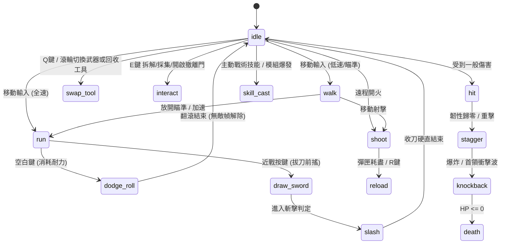

# 《廢土回收商 (Wasteland Recycler)》角色與戰鬥動畫技術規範 (ANIMATION SPEC)

> **文件版本**：v2.0 (AAA-Quality 8 方向全動態重製規範)
> **制定單位**：美術總監與 UI/UX 總監 (`art-director`)
> **實際執行模型紀錄**：`Gemini 4 Argon (art-director subagent)`
> **適用對象**：主角 R-17 (`112x128` 單格 / `8064x1024` 主圖集)、模組化武器掛載層 (`WeaponOverlay`)、六大類廢土敵人 (`96x96` 單格)

---

## 1. 主角 8 方向座標系與圖集列映射規範 (8-Directional Coordinate & Row Mapping)

主角主圖集（`player_master_atlas.png`）尺寸為 **`8064x1024` px**，單格尺寸 **`112x128` px**，共分為 **8 列（Rows 0–7，代表 8 個方位）× 72 欄（Columns 0–71，代表 9 大核心動作 × 每動作 8 幀）**。

### 8 方向解剖透視、遮擋與步態鐵律

為徹底根除早期版本「Row 5/6/7（背面三方向）腿部靜止滑步、背包與正面混淆」的缺陷，所有 8 方向動畫必須嚴格遵守以下解剖與透視規範：

| 圖集列 (Row) | 方向代號 (Dir Key) | 羅盤方位 / 角度 | 頭部與護目鏡可見度 | 背包與披風可見度 | 持武手部遮擋關係 (`WeaponOverlay`) | 雙腿交替步態規範 (Leg Alternation) |
| :--- | :--- | :--- | :--- | :--- | :--- | :--- |
| **Row 0** | `right` | 東 (E, 0°) | 右側單眼護目鏡高光 (`#4BE3E3`)、防毒面罩側輪廓與連帽側翼 | 背部左側露出反應爐側面輪廓與披風後擺 | **武器在身體前方** (`z_index = +1`)，右手持槍/刀於胸腹前方延伸 | 前後水平跨步剪影；右腿（近端）與左腿（遠端，明度降 15%）明確交叉交替 |
| **Row 1** | `down_right` | 東南 (SE, 45°) | 3/4 側面雙眼護目鏡（右眼寬、左眼窄透視），面罩呼吸閥清晰 | 左後肩露出半邊背包頂蓋與青色導管，右胸可見背帶 | **武器在身體前方** (`z_index = +1`)，斜向右下延伸，左托手輔助支撐 | 45° 斜向跨步；雙膝高低起伏明顯，腳掌隨步伐呈現落地與蹬地透視 |
| **Row 2** | `down` | 南 (S, 90°) | 正面雙眼對稱護目鏡高光、戰術圍巾與領口護甲完整呈現 | 背包主體被軀幹遮擋，雙肩清晰可見**雙側戰術背帶與胸前扣具** | **武器在身體最前方** (`z_index = +1`)，橫跨腹部或指向正下方 | 上下垂直透視跨步；透過大腿受光面積伸縮與靴底黑影前後位移展現真實踏步 |
| **Row 3** | `down_left` | 西南 (SW, 135°) | 3/4 側面雙眼護目鏡（左眼寬、右眼窄透視），面罩側濾罐清晰 | 右後肩露出半邊背包頂蓋，左胸可見戰術背帶與通訊器 | **武器在身體前方** (`z_index = +1`)，斜向左下延伸，遮擋部分下半身護甲 | 135° 斜向跨步；左腿與右腿在全部 8 幀中嚴格執行「前跨—支撐—後蹬—抬起」循環 |
| **Row 4** | `left` | 西 (W, 180°) | 左側單眼護目鏡高光、面罩側輪廓與連帽側翼 | 背部右側露出反應爐側面輪廓與外掛回收鉗 | **武器在身體前方/側面** (`z_index = +1`)，持武手臂位於近端視覺層 | 前後水平跨步剪影；近端腿與遠端腿（深色陰影層）完整前後擺動 |
| **Row 5** | `up_left` | 西北 (NW, 225°) | **護目鏡不可見**；完整呈現連帽左後側立體布料摺皺与防風領後緣 | **背部反應爐高比例顯露**（偏右側 3/4 視角），`#4BE3E3` 核心發光與披風斜擺為主視覺 | **武器部分被軀幹與左肩遮擋** (`z_index = -1`)，僅槍口/刀尖自左上方探出 | **強制雙腿獨立交替（禁止靜態滑行）**：左後腿蹬地時露出靴底，右前腿向左上跨出時膝蓋外擴 |
| **Row 6** | `up` | 北 (N, 270°) | **護目鏡完全不可見**；正背面連帽垂墜尖端與頸部裝甲環清晰可辨 | **背包正背面完整呈現**：中央圓形 `#4BE3E3` 反應爐核心、兩側散熱柵與下擺翡翠綠披風 | **武器被軀幹與大背包遮擋** (`z_index = -1`)，僅在揮砍外擺或高舉時露出邊緣 | **強制雙腿獨立交替（禁止靜態滑行）**：透過披風下擺左右掀起、左右戰術靴高低落差（`4px–6px`）與靴底暗面交替呈現真實奔跑 |
| **Row 7** | `up_right` | 東北 (NE, 315°) | **護目鏡不可見**；完整呈現連帽右後側立體摺皺 | **背部反應爐高比例顯露**（偏左側 3/4 視角），能量管線與披風動態擺動 | **武器部分被軀幹與右肩遮擋** (`z_index = -1`)，槍管/刀身自右上方探出 | **強制雙腿獨立交替（禁止靜態滑行）**：右後腿蹬地露出靴底厚跟，左前腿向右上跨步提膝 |

---

## 2. 動畫狀態機與幀時序總表 (Animation State Machine & Frame Timing)

主角動畫系統由 **9 組主圖集原生動作（Core Atlas Actions）** 與 **6 組引擎驅動/擴充戰術動作（Engine-Driven & Extended States）** 構成，實現高響應度的動作手感的同時，保持像素圖集的精簡高效率。

### 2.1 主圖集 9 大核心動作規格（`8064x1024` Atlas, 每動作 8 幀）

| 動作名稱 (Action ID) | 圖集欄位 (Cols) | 像素 X 範圍 | 幀數 | 播放速率 (FPS) | 循環 (Loop) | 前搖 (Anticipation) | 作用/判定幀 (Active) | 後搖恢復 (Recovery) | 動態設計與打擊感規範 |
| :--- | :--- | :--- | :--- | :--- | :--- | :--- | :--- | :--- | :--- |
| **`idle`** (戰術待機) | Col 0–7 | `0–895` | 8 | 8 FPS | 是 | — | Frame 0–7 (呼吸起伏) | — | 胸廓與背包隨呼吸上下微幅位移 `1–2px`，披風尾端微幅擺動，護目鏡在第 4 幀掠過一道微弱青光 |
| **`walk`** (戒備行走) | Col 8–15 | `896–1791` | 8 | 10 FPS | 是 | Frame 0, 4 (跨步起點) | Frame 1–2, 5–6 (全腳掌著地) | Frame 3, 7 (重心轉換) | 持槍平舉穩定推進；Frame 1 與 Frame 5 觸發輕微腳步揚塵粒子與低頻踏地音效 |
| **`run`** (全速衝刺) | Col 16–23 | `1792–2687` | 8 | 14 FPS | 是 | Frame 0, 4 (蹬地蓄力) | Frame 1–2, 5–6 (騰空跨步) | Frame 3, 7 (落地緩衝) | 軀幹前傾 15°，披風向後大幅揚起呈流線扇形；8 個方向雙腿皆有高達 `10–14px` 的前後跨距 |
| **`shoot`** (遠程射擊) | Col 24–31 | `2688–3583` | 8 | 16 FPS | 否 (連發可重觸發) | Frame 0 (沉肩瞄準) | **Frame 1–2** (槍口火光+子彈生成+後座力後退 `3px`) | Frame 3–7 (槍口上揚抑制與復位) | Frame 1 同步觸發 `WeaponOverlay` 後座位移與槍口閃光粒子；Frame 4 拋出微型彈殼 |
| **`draw_sword`** (拔刀蓄力) | Col 32–39 | `3584–4479` | 8 | 18 FPS | 否 | **Frame 0–4** (壓低重心、右手按上背後/腰間刀柄、護目鏡爆亮) | Frame 5–6 (刀鋒出鞘寒光一閃 `#4BE3E3`) | Frame 7 (銜接 `slash` 起手式) | 為近戰連段提供極具張力的「居合蓄力」瞬間，可隨時無縫切入 `slash` |
| **`slash`** (重型揮砍) | Col 40–47 | `4480–5375` | 8 | 20 FPS | 否 | Frame 0–1 (扭腰拉滿刀弧) | **Frame 2–4** (160° 廣角電漿刀弧 smear frame + 角色前踏 `4px`) | Frame 5–7 (殘影消散、收刀回防) | **近戰 Hitbox 僅在 Frame 2–4 開啟**；Frame 2 附加 `40ms` 命中頓幀（Hitstop）強化切割手感 |
| **`swap_tool`** (切換武裝/工具) | Col 48–55 | `5376–6271` | 8 | 16 FPS | 否 | Frame 0–2 (收起當前武器至背包磁吸扣) | **Frame 3–5** (背包反應爐閃爍、抽出新武器/拆解焊槍) | Frame 6–7 (雙手持穩就緒) | Frame 4 完成底層武器資料與 `WeaponOverlay` 貼圖切換，附帶清脆機械上膛聲 |
| **`interact`** (拆解/回收作業) | Col 56–63 | `6272–7167` | 8 | 12 FPS | 是 (作業期間循環) | Frame 0–1 (單膝微蹲、啟動電漿切割器) | **Frame 2–6** (持續噴射 `#FF7832` 鍛造火花與 `#4BE3E3` 掃描波) | Frame 7 (收回工具準備下一循環) | 配合環境資源箱/廢車拆解進度條，提供明確的「正在回收作業中」視覺回饋 |
| **`hit`** (受擊硬直) | Col 64–71 | `7168–8063` | 8 | 16 FPS | 否 | Frame 0 (瞬間受創仰頭、全身閃白 `Shader Flash`) | **Frame 1–4** (軀幹後仰、披風掀動、護目鏡閃現警告紅光) | Frame 5–7 (咬牙穩住重心回復待機) | Frame 0–2 期間提供短暫受擊保護，防止被多發散彈瞬間秒殺 |

### 2.2 引擎驅動與擴充戰術動作狀態（Engine-Driven & Extended States）

以下 6 個高階戰鬥狀態結合主圖集關鍵幀與 Godot 4.6 `Tween` / `Shader` / `WeaponOverlay` 動態程序化控制，實現流暢的 60 FPS 戰術反饋：

| 擴充狀態 (State ID) | 基底幀來源 | 總時長 / 等效幀 | 前搖 (Anticipation) | 作用/無敵幀 (Active / I-Frames) | 後搖恢復 (Recovery) | 程序化動態與視覺特效規範 |
| :--- | :--- | :--- | :--- | :--- | :--- | :--- |
| **`dodge_roll`** (戰術翻滾/滑步) | `run` Frame 2, 3, 6 + 壓縮傾角 | `0.32s` (等效 8 幀 @ 25 FPS) | `0.00–0.04s` (Frame 0: 瞬間壓低中心縮放 `scale.y = 0.82`) | **`0.04–0.24s` (Frame 1–5: 關閉 Hurtbox 無敵幀，產生 3 道 `#4BE3E3` 半透明青色殘影)** | `0.24–0.32s` (Frame 6–7: 單手撐地煞車揚塵，恢復 `scale = 1.0`) | 翻滾期間隱藏或收攏 `WeaponOverlay`，位移曲線採用 `TRANS_CUBIC` (`EASE_OUT`) 呈現爆發初速與尾段急停 |
| **`reload`** (戰術換彈) | `swap_tool` Frame 1–6 循环 + 武器層動畫 | 依武器 `0.8s–1.6s` (等效 10 幀) | 前 20% 時間 (退下空彈匣，拋出落地小物件) | 中段 50% 時間 (`WeaponOverlay` 下傾 25°，新彈匣嵌入背包能量槽充能) | 後 30% 時間 (拉動槍機上膛，`WeaponOverlay` 向上彈跳 `2px` 復位) | 頭頂同步顯示精巧像素換彈進度條（`#E8A838` 琥珀色），可被 `dodge_roll` 隨時中斷取消 |
| **`stagger`** (破防失衡) | `hit` Frame 2–5 往復震盪 | `0.60s` (等效 8 幀 @ 13 FPS) | `0.00–0.10s` (護盾破裂玻璃碎裂特效 `#4CA6E8`) | `0.10–0.45s` (角色左右搖晃 `±3px`，頭頂浮現琥珀色失衡電弧，無法開火) | `0.45–0.60s` (甩頭重啟護目鏡系統) | 當玩家護盾被重型攻擊打穿或遭受結晶共鳴脈衝時觸發 |
| **`knockback`** (強制擊飛) | `hit` Frame 1–3 鎖定 + 拋物線位移 | `0.45s` (等效 7 幀) | `0.00–0.05s` (受擊頓幀 + 衝擊波擴散環) | `0.05–0.30s` (雙腳離地 `Y軸偏移 -10px`，沿受擊反方向高速滑退並留下一道雙軌刮痕) | `0.30–0.45s` (重摔落地激起沙塵，短暫倒地緩衝) | 與地形碰撞箱（CollisionShape2D）嚴格互動，撞牆時提前結束滑行並觸發牆面碎屑 |
| **`death`** (力竭倒下) | `hit` Frame 0–4 → 倒地定格姿態 | `1.10s` (等效 12 幀，不循環) | `0.00–0.25s` (慢動作受創後仰，背包反應爐爆出失控電火花) | `0.25–0.70s` (膝蓋跪地後向側前方傾倒，`WeaponOverlay` 脫手掉落一旁地面) | `0.70–1.10s` (護目鏡與背包 `#4BE3E3` 青光由亮轉暗熄滅，轉為灰暗殘骸) | 觸發畫面邊緣暗角收縮與死亡結算 UI 淡入 |
| **`skill_cast`** (模組超載爆發) | `draw_sword` Frame 3–5 + `interact` Frame 4 | `0.50s` (等效 8 幀 @ 16 FPS) | `0.00–0.15s` (單手高舉或猛擊地面，背包核心亮度提升 200%) | **`0.15–0.35s` (釋放 360° 能量脈衝環 / 召喚無人機 / 啟動超載護盾)** | `0.35–0.50s` (能量餘波散去，無縫接回戰鬥待機) | 給予高階改造模組（Mods）與主動技能極具儀式感的施放瞬間 |

---

## 3. 模組化武器掛載層錨點規範 (`WeaponOverlay` Anchor Points)

主角單格尺寸為 `112x128` px，角色視覺中心與腳底基準點為 **`(56, 114)`**。`WeaponOverlay` 以相對於單格左上角 `(0, 0)` 的像素座標進行動態綁定，並根據 8 方向自動切換渲染層級（`z_index`）與基準旋轉角：

| 方向列 (Row) | 方向代號 | 持武手部錨點 `(x, y)` | 渲染層級 (`z_index`) | 基準旋轉角 (`rotation_deg`) | 水平翻轉 (`flip_h`) | 槍口火光生成偏移 (Muzzle Offset) |
| :--- | :--- | :--- | :--- | :--- | :--- | :--- |
| **Row 0** | `right` (E) | `(66, 74)` | `+1` (主角前方) | `0°` | `false` | `(+26, -2)` |
| **Row 1** | `down_right` (SE) | `(62, 78)` | `+1` (主角前方) | `+35°` | `false` | `(+22, +14)` |
| **Row 2** | `down` (S) | `(54, 82)` | `+1` (主角最前方) | `+85°` | `false` | `(+2, +24)` |
| **Row 3** | `down_left` (SW) | `(50, 78)` | `+1` (主角前方) | `-35°` | `true` | `(-22, +14)` |
| **Row 4** | `left` (W) | `(46, 74)` | `+1` (主角前方) | `0°` | `true` | `(-26, -2)` |
| **Row 5** | `up_left` (NW) | `(48, 68)` | **`-1` (主角與背包後方)** | `+30°` | `true` | `(-20, -14)` |
| **Row 6** | `up` (N) | `(58, 64)` | **`-1` (主角與背包後方)** | `-85°` | `false` | `(+4, -24)` |
| **Row 7** | `up_right` (NE) | `(64, 68)` | **`-1` (主角與背包後方)** | `-30°` | `false` | `(+20, -14)` |

* **動態抖動補償（Bobbing Offset）**：在 `walk` 與 `run` 狀態下，奇數支撐幀（Frame 1, 2, 5, 6）錨點 `y` 軸自動 `+2px`（下沉），偶數過渡幀（Frame 0, 3, 4, 7）`y` 軸 `-1px`（回彈），確保武器與身體律動完全同步。

---

## 4. 碰撞框、受擊框與攻擊判定框規範 (Hitbox / Hurtbox / Collision Shapes)

為實現「擦彈有驚無險、揮砍打擊爽快、走位不卡地形」的 2.5D 黃金判定比例，所有實體嚴格分離以下三組碰撞區域（以角色腳底錨點 `(0, 0)` 為相對原點）：

1. **物理移動碰撞框 (`WorldCollision` - `CollisionShape2D`)**：
   * **形狀**：扁平膠囊形 / 橢圓形（`CapsuleShape2D`，橫向旋轉 90°）。
   * **主角尺寸**：寬 `28px` × 深 `14px`，中心偏移 `(0, -6)`（僅包覆雙腳靴底區域）。
   * **設計目的**：確保主角上半身與連帽可自然遮擋在掩體、廢車與牆角前方（Y-Sort 深度排序），走位穿過狹窄通道時絕不因披風或頭盔卡住。
2. **受擊判定框 (`Hurtbox` - `Area2D`)**：
   * **形狀**：直立膠囊形（`CapsuleShape2D`）。
   * **主角尺寸**：寬 `24px` × 高 `46px`，中心偏移 `(0, -28)`（僅涵蓋軀幹與胸腹核心，**比視覺像素輪廓內縮約 20%**，披風邊緣與連帽尖端不計入受擊）。
   * **敵人尺寸（`96x96` 畫布）**：
     * 輕型敵人（變異潛行者 `stalker`、腐蝕蟲群 `vermin`）：寬 `26px` × 高 `38px`
     * 標準敵人（鐵鏽暴徒 `brute`、結晶狂熱者 `zealot`）：寬 `34px` × 高 `52px`
     * 重型菁英 / 首領（裝甲巨像 `juggernaut`、深淵收割者 `harvester`）：寬 `54px` × 高 `68px`
3. **攻擊傷害判定框 (`Hitbox` - `Area2D`)**：
   * **主角近戰揮砍 (`slash` Frame 2–4)**：160° 扇形多邊形或寬闊圓弧（半徑 `68px`，中心沿面向前方偏移 `+32px`），給予微幅外擴（Generous Hitbox）確保爽快割草與砍碎彈幕體驗。
   * **遠程投射物 (`Projectile`)**：子彈核心判定圓半徑 `4px`（電漿重砲為 `8px`），外圍視覺光暈不觸發誤判，確保敵我彈幕走位精準公平。
