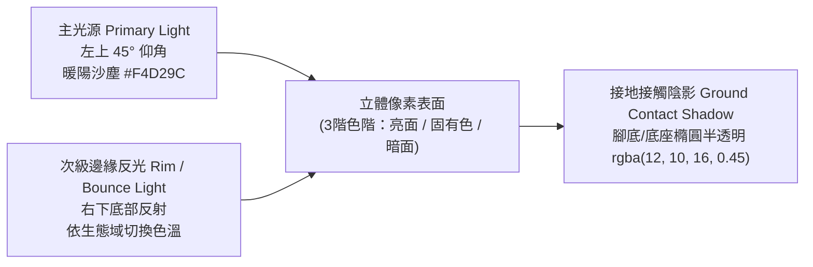

# 《廢土回收商 (Wasteland Recycler)》美術設定聖經 (ART BIBLE)

> **文件版本**：v2.0 (AAA-Quality 視覺重製規範)
> **制定單位**：美術總監與 UI/UX 總監 (`art-director`)
> **實際執行模型紀錄**：`Gemini 4 Argon (art-director subagent)`
> **引擎平台**：Godot 4.6 (`gl_compatibility` / Pixel-Perfect 2.5D 渲染管線)

---

## 1. 廢土像素美術風格總綱 (Wasteland Pixel Art Style)

《廢土回收商 (Wasteland Recycler)》採用**高工藝 2.5D 俯視斜角像素美術（High-Craft 2.5D Top-Down Oblique Pixel Art）**，攝影機傾角設定為 **35°–45°（3/4 視角）**。視覺標竿致敬並融合以下經典作品之長處：

1. **《Hyper Light Drifter》**：高飽和霓虹能量色（青、紫紅、翠綠）與荒涼低彩度廢土背景的強烈冷暖對比，賦予科技遺物與水晶裂谷神祕而銳利的視覺張力。
2. **《Eastward (風來之國)》**：溫暖厚實的太陽塵埃受光、細膩的手工像素材質肌理（鏽蝕鐵皮、剝落油漆、粗麻斗篷），以及極具生活感的據點建築細節。
3. **《Children of Morta》**：流暢的 8 方向角色動態剪影、明確的披風與肢體慣性跟隨（Follow-through），以及高辨識度的近戰揮砍/遠程射擊特效光影。
4. **《Zero Sievert》**：硬派末日生存戰術感、緊湊清晰的環境掩體與資源點輪廓，確保高壓交戰下的戰場資訊一目了然。

### 核心視覺三大鐵律
* **三秒剪影辨識法則（3-Second Silhouette Rule）**：將任何角色、敵人、可互動建築或危險物轉為純黑剪影時，玩家必須在 0.25 秒內分辨出「主角 / 感染者 / 裝甲暴徒 / 掩體 / 可拆解資源 / 撤離門」。
* **材質層次分離（Material Separation）**：嚴格區分「粗糙吸光材質（布料、沙土、腐殖泥）」與「高光反射材質（護目鏡玻璃、能量核心、精煉鋼板、結晶體）」，禁止全畫面平均受光。
* **零視覺雜訊（Zero Artificial Noise）**：嚴禁在角色、NPC、建築或圖塊角落殘留 AI 生成偽影、孤立雜點、無意義的角標徽章或半透明毛邊。所有邊緣必須符合選擇性描邊（Selective Outlining）規範。

---

## 2. 統一像素密度與畫布規格標準 (Unified Pixel Density & Canvas Standards)

為確保全遊戲無「混用像素尺寸（Mixels）」並支援多解析度清晰縮放，全專案統一遵循以下畫布與圖集規範：

| 資產類別 | 畫布 / 單格尺寸 | 圖集 / 延伸規格 | 對齊錨點與描邊規範 |
| :--- | :--- | :--- | :--- |
| **基準視窗 (Base Viewport)** | `1280x720` px | 原生支援 `1024x768` (4:3 戰術視野) 與 `1920x1080` (FHD 1.5x 等比縮放) | `canvas_items` 縮放模式，UI 獨立錨點自適應 |
| **主角動畫單格 (Protagonist Cell)** | `112x128` px / frame | 主圖集 `8064x1024` px（9 動作橫排 × 每動作 8 幀 = 72 欄；8 方向縱列 = 8 列） | 腳底中心對齊 `(56, 114)`；預留揮砍/翻滾外擴安全框；搭配模組化武器掛載層 (`WeaponOverlay`) |
| **敵人動畫單格 (Enemy Cell)** | `96x96` px / frame | 獨立運行圖條 `384x96` px（4 幀循環）；六大類敵人總覽表 `1344x768` px | 腳底中心對齊 `(48, 86)`；外圍 `1px` 深色輪廓線 `#121015` |
| **據點與野外 NPC (NPC Canvas)** | `220x260` px RGBA | 獨立透明背景立繪/場景精靈 | 乾淨剪影，嚴禁角落人工徽章或背景殘影；底部接觸陰影置中 |
| **據點與地標建築 (Structure Canvas)** | `420x250` 至 `560x420` px RGBA | 依建築體量分級（工作台/商店 `420x250`、主基地/撤離門 `560x420`） | 具備厚重接地環境遮蔽陰影（Grounded AO Shadow）與獨特屋頂/天線天際線 |
| **地表無縫圖塊 (Ground Tile Atlas)** | `512x128` px 與 `384x256` px | `512x128` 含 4 組 `128x128` 隨機地表變體；`384x256` 為 3×2 無縫 2.5D 轉角/邊界圖塊 | 嚴格四邊無縫拼接（Seamless Tiling），地表對比度控制在 15%–25% 避免干擾戰鬥 |
| **道具/武器/模組圖示 (Item Icon)** | `64x64` px RGBA | 武器、廢料、消耗品、改造模組統一 `64x64` px | 外圍 `1px` 選擇性深色描邊（`#121015`）+ 左上內側 `1px` 高光邊（Inner Rim Highlight） |
| **高解析護甲圖示 (High-DPI Armor)** | `128x128` px RGBA | 專用於 `初階.png`、`中階.png`、`高階.png` 護甲核心展示 | 雙倍細節密度展示胸甲、肩甲與能量管線演進，同樣具備 `#121015` 描邊與內高光 |

---

## 3. 光影與立體著色規則 (Lighting & Shading Rules)

所有角色、建築、道具與地貌圖塊均採用統一的三層式光影模型，確保全場景在同一個物理光源下融合：

1. **主光源（Primary Light Source）**：
   * **方位**：固定自畫面**左上角（Top-Left）45° 仰角**投射。
   * **色溫**：溫暖的廢土日光塵埃色（`#F4D29C`）。所有物體的左上方受光面須往暖黃/高明度偏移，色相微向暖色旋轉（Hue Shifting）。
2. **次級邊緣光與環境反光（Secondary Rim / Bounce Light）**：
   * **方位**：來自畫面**右下角（Bottom-Right）**的地面反射與背光輪廓。
   * **生態域動態反光色**：
     * 一般廢土 / 水晶區：冰青色反光（`#4CE0B3`）
     * 劇毒沼澤 / 生化區：毒酸綠反光（`#8CE63A`）
     * 舊工廠 / 熔爐高溫區：餘燼橘反光（`#FF6B35`）
   * **作用**：將角色的暗部背光面（往冷紫灰 `#1E1A28` 偏移）與深色地面分離，防止暗部糊成一團。
3. **接地接觸陰影（Ground Contact Shadow）**：
   * **規範**：所有可動實體與獨立道具底部必須繪製或掛載柔和的橢圓形半透明陰影，色值統一為 `rgba(12, 10, 16, 0.45)`，錨定於雙腳中心點或建築底座基線，杜絕「角色漂浮在地圖上」的抽離感。
4. **選擇性描邊（Selective Outlining）**：
   * 外輪廓統一使用深炭紫黑 `#121015`（`1px` 實心，禁止外圍半透明羽化）。
   * 內部結構分界線採用深色固有色（較鄰近色塊暗 35%）取代純黑線，維持內部體積感。

---

## 4. 全局色彩系統 (Color Palette System)

專案制定 7 大標準色盤家族，所有新舊美術資產必須嚴格取色自此色盤系統：

| 色盤家族 (Palette Family) | 暗部陰影 (Shadow) | 核心固有色 (Base Midtone) | 受光高光 (Highlight) | 視覺職責與應用範圍 |
| :--- | :--- | :--- | :--- | :--- |
| **1. 廢土基底中性色 (Base Wasteland Neutrals)** | `#1A171F` | `#4A4238` / `#6E6254` | `#A89882` | 柏油路面、風化砂岩、混凝土殘骸、背景低干擾基底 |
| **2. 鐵鏽與廢金屬 (Rust & Scrap Metals)** | `#2C1B18` | `#7A3E26` / `#525C66` | `#B86B43` / `#8C9AA8` | 廢棄車殼、鍛造台、裝甲板、近戰鋸刃與可回收金屬件 |
| **3. 拾荒者軍綠/翡翠 (Survivor Olive/Emerald)** | `#193326` | `#2E5A44` | `#4F8A6B` | 主角 R-17 披風/戰術服、據點防風帆布、安全撤離信標 |
| **4. 核心能量青 (Core Energy Cyan)** | `#14525C` | `#2299AA` | `#4BE3E3` | 主角背包反應爐、護目鏡鏡片、電漿武器、閃避殘影 |
| **5. 生化劇毒綠 (Hazard Toxic)** | `#244D14` | `#4FA322` | `#7AE838` | 毒沼酸液池、變異孢子、腐蝕異常狀態、高危生化桶 |
| **6. 裂谷水晶紫紅 (Crystal Violet/Magenta)** | `#3B1454` | `#8428B8` | `#C850F0` | 高能紫水晶簇、能量共鳴脈衝、高階科技模組、異變首領 |
| **7. 熔爐餘燼橘 (Forge Ember)** | `#5E1E0E` | `#C4451C` | `#FF7832` | 舊工廠熔爐、鍛造火花、爆炸油桶警示、暴擊/高溫傷害 |

---

## 5. 主角三方案概念設計比對與最終定案 (Protagonist 3-Concept Comparison & Final Selection)

為確立《廢土回收商》最具標誌性的主角視覺形象，我們針對「廢土拾荒、高速機動、模組化武裝、三階護甲演進」四大核心體驗，設計並評估了三套概念方案：

### 三方案全方位評估表

| 評估維度 | 方案 A：廢鐵堡壘 (Concept A: Scrap Bastion) | 方案 B：R-17 先鋒進化版 (Concept B: R-17 Vanguard - Evolved) ⭐ **最終定案** | 方案 C：生化潛行者 (Concept C: Bio-Hazard Stalker) |
| :--- | :--- | :--- | :--- |
| **核心造型語彙** | 重型不對稱焊裝甲、巨型液壓機械臂、全封閉焊接頭盔、無披風厚重軀幹 | 戰術風衣連帽斗篷 (`#2E5A44`)、雙發光青色護目鏡 (`#4BE3E3`)、模組化回收反應爐背包、俐落複合胸甲 | 輕量化橡膠防毒衣、長鳥嘴防毒面具、外掛玻璃藥劑瓶、細長駝背輪廓 |
| **8 方向剪影辨識度** | **中低**：四肢短粗且無披風導引，正面與背面在 `112x128` 下極易看成同一個圓筒鐵罐 | **極高**：正側面看護目鏡與不對稱肩甲，背面看連帽垂墜與發光背包核心，8 方向朝向瞬間可辨 | **中等**：四肢過於纖細，在廢墟與毒沼背景中容易與「變異潛行者 (Stalker)」敵人混淆 |
| **披風與動態物理表現** | 無披風，跑步與揮砍缺乏次級動態（Secondary Motion），打擊感偏僵硬 | 連帽短披風具備極佳的飄動扇形軌跡，衝刺、翻滾與拔刀斬時能強化速度線與慣性張力 | 下擺過長且貼腿，導致 8 方向腿部交替跨步被嚴重遮擋，降低移動步態清晰度 |
| **背包能量核心辨識** | 背部為厚重排氣煙囪，色調與鐵鏽地面過於接近，缺乏視覺焦點 | 背部鑲嵌高對比「核心能量青 (`#4BE3E3`)」反應爐與回收磁軌，背面作戰時依然是全場視覺中心 | 背部為透明綠液體罐，在劇毒沼澤 (`#7AE838`) 地圖中完全失去對比度 |
| **三階護甲視覺演進** | 初始即過度厚重，初階→中階→高階僅能增加尖刺，缺乏層次遞進感 | **初階**（輕裝防塵披風+皮革護胸）→ **中階**（合金複合肩甲+強化反應爐）→ **高階**（全覆式泰坦戰術外骨骼+電漿光翼導流器），成長感極度鮮明 | 防護服材質受限，升級高階護甲時與「生化潛行」主題產生視覺衝突 |
| **敘事延續性** | 與現有「代號 R-17 廢土回收專家」設定脫節 | 完美承襲 R-17 經典設定，並全面升級像素精細度、解剖比例與光影立體感 | 偏向醫療/化學兵種，削弱了「萬能機械拆解與武器鍛造商」的核心身分 |

### 最終決策：**選定【方案 B：R-17 先鋒進化版 (Concept B: R-17 Vanguard - Evolved)】**

1. **完美承接敘事與品牌記憶點**：保留玩家熟悉的「代號 R-17」戰術連帽與雙發光護目鏡特徵，同時將頭身比優化為更具英雄感的 **3.5 頭身戰術比例**（站立高度約 `84px`，居於 `112x128` 畫布中央偏下，為揮砍弧線與大槍管預留充裕空間）。
2. **8 方向朝向零死角**：
   * **正面/斜前（S, SE, SW）**：高亮度 `#4BE3E3` 青色雙眼護目鏡、深綠戰術領巾、斜跨胸前的回收能量帶與雙肩背包帶清晰可見。
   * **側面（E, W）**：護目鏡單側透視、流線型連帽輪廓、背部外突的回收反應爐側面剖面與前後擺動的雙腿形成明確的前進箭頭。
   * **背面/斜後（N, NW, NE）**：完整展示連帽與戰術披風 (`#2E5A44` / `#4F8A6B`) 的立體摺皺，以及背包中央閃耀的 `#4BE3E3` 反應爐核心與磁吸工具架，徹底解決舊版背面方向模糊的問題。
3. **模組化武器與三階護甲無縫整合**：
   * 獨立分離 `WeaponOverlay` 武器掛載層，讓 R-17 無論切換手槍、霰彈槍、磁軌步槍或電漿切割刀，皆能精準貼合手部錨點並支援前後層級遮擋。
   * 護甲圖示（`初階.png`、`中階.png`、`高階.png` 採 `128x128` 高解析繪製）與角色外觀演進共享同一套材質語言：由「廢土皮革與防塵布」演進至「高強度軍規鈦合金與青色能量導管」。
