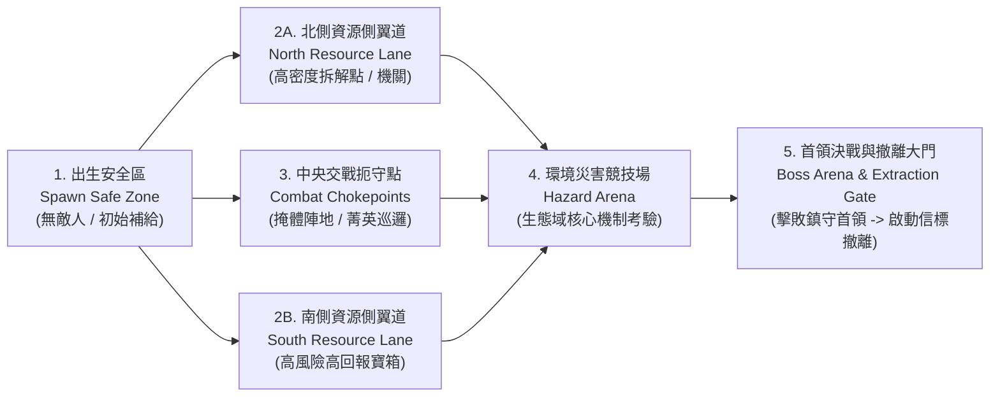

# 《廢土回收商 (Wasteland Recycler)》六大廢土生態域與關卡設計規範 (BIOME DESIGN)

> **文件版本**：v2.0 (4 大核心生態域重製 + 2 大終局生態域擴充)
> **制定單位**：美術總監與 UI/UX 總監 (`art-director`)
> **實際執行模型紀錄**：`Gemini 4 Argon (art-director subagent)`
> **適用系統**：世界地圖選關、程序化種子地圖生成 (`Seed-based Procedural Generation`)、環境災害與敵人配置

---

## 1. 六大廢土生態域總覽矩陣 (6 Wasteland Biomes Overview)

專案共規劃 **6 大廢土生態域**：包含全面視覺與機制重製的 **4 大核心路線**，以及全新擴充的高難度 **2 大終局路線（Endgame Routes）**。

| 生態域代號 (Biome ID) | 中文名稱 | 路線定位與推薦階段 | 主導色調 (Dominant Palette) | 次級邊緣反光 (Rim Light) | 標誌性環境危害機制 (Signature Hazards) |
| :--- | :--- | :--- | :--- | :--- | :--- |
| **`scrap_highway`** | **廢鐵公路** | 核心路線 Tier 1 (新手/基礎金屬回收) | 暖沙褐 `#A89882`、鐵鏽紅 `#7A3E26`、柏油灰 `#3A363C` | 暖陽沙塵 `#F4D29C` | **強風沙塵暴陣風 (Dust Gusts)** + **連鎖爆炸油桶 (Exploding Barrels)** |
| **`toxic_marsh`** | **劇毒沼澤** | 核心路線 Tier 2 (生化材料/高機動考驗) | 腐殖深綠 `#193326`、毒酸綠 `#7AE838`、污泥褐 `#4A3F35` | 毒酸螢光綠 `#8CE63A` | **腐蝕酸液池 (Corrosive Acid Pools)** + **孢子毒霧噴孔 (Spore Geysers)** |
| **`crystal_scar`** | **結晶裂谷** | 核心路線 Tier 3 (高能晶體/護盾壓力測試) | 玄武岩紫黑 `#22182E`、裂谷紫紅 `#C850F0`、能量青 `#4BE3E3` | 冰青色反光 `#4CE0B3` | **水晶共鳴脈衝 (Crystal Resonance Pulses)** + **折射雷射稜鏡 (Prismatic Shards)** |
| **`old_factory`** | **舊時代兵工廠** | 核心路線 Tier 4 (高階零件/精密機械拆解) | 鋼鐵灰藍 `#46525E`、熔爐餘燼橘 `#FF7832`、警示黃 `#E8A838` | 餘燼橘反光 `#FF6B35` | **高壓蒸氣噴口 (Steam Vents)** + **週期性電擊地板網 (Shock Grids)** |
| **`ruined_metropolis`** | **崩毀大都會** *(New)* | 終局路線 Tier 5 (立體巷戰/高價值戰前科技) | 冷調混凝土 `#5C646E`、霓虹殘光青 `#2299AA`、狙擊紅 `#D94141` | 冷都市青 `#4CE0B3` | **高樓狙擊交叉火網 (Sniper Crossfire)** + **危樓落石崩塌區 (Collapse Zones)** |
| **`underground_facility`** | **深淵地下實驗室** *(New)* | 終局路線 Tier 6 (最高機密原型武裝/終極首領) | 無菌鈦白灰 `#7A8896`、深淵暗藍 `#141C28`、警報赤紅 `#E63946` | 實驗室冷青 `#4BE3E3` | **動態保全雷射網 (Security Lasers)** + **失控低溫冷凍艙 (Cryo-Pods)** |

---

## 2. 各生態域深度視覺與機制規範 (Detailed Biome Specifications)

### 2.1 廢鐵公路 (`scrap_highway`) — 核心路線 Tier 1
* **視覺主題與地形剪影**：斷裂的洲際高架橋與乾涸紅土河床交錯。地表由龜裂柏油路面（含褪色雙黃線）與風化黃沙構成，視野開闊、掩體分佈直觀。
* **色彩計畫**：基底採用低飽和暖沙 `#A89882` 與深灰柏油 `#3A363C`；掩體強調高飽和鐵鏽橘紅 `#B86B43` 與剝落藍漆車殼。
* **建築語彙與環境道具**：傾倒的貨櫃屋、生鏽加油站頂棚、廢棄八輪卡車殘骸、輪胎堆掩體、路標牌與高壓電塔基座。
* **光影與氣候特效**：左上角強烈暖陽直射，空氣中漂浮緩慢向右下移動的金色沙塵粒子（`GPUParticles2D`）。
* **敵人配置與探索節奏**：
  * 主力：**拾荒暴徒 (`brute`)** 與 **野生變異犬/潛行者 (`stalker`)**。
  * 節奏：前段寬鬆引導拆解廢車與收集基礎廢鐵，中段利用加油站掩體進行槍戰教學。
* **專屬環境危害機制**：
  1. **強風沙塵暴陣風 (Dust Gusts)**：每 `25s` 吹起持續 `5s` 的橫向沙暴（伴隨風聲預警與沙塵遮罩），順風移動速度 `+25%`、逆風 `-25%`，迫使玩家調整走位。
  2. **連鎖爆炸油桶 (Exploding Barrels)**：漆有 `#FF7832` 火焰標誌的紅鏽油桶，受擊 `1.2s` 後劇烈引爆（半徑 `110px` 造成高額火焰傷害並點燃地面 `4s`），可誘導敵群聚集後一舉引爆。

---

### 2.2 劇毒沼澤 (`toxic_marsh`) — 核心路線 Tier 2
* **視覺主題與地形剪影**：被生化廢料污染的沉沒工業濕地。曲折的腐朽木棧道、外露的巨大生鏽排污管與冒泡的螢光綠泥沼形成高對比路徑。
* **色彩計畫**：深幽暗綠泥地 `#193326` 襯托高亮度 `#7AE838` 劇毒酸池，搭配鏽蝕銅管 `#6E5A4F` 與蒼白枯木 `#8A8C82`。
* **建築語彙與環境道具**：半沉沒的化學儲液槽、防化帳篷殘骸、架高金屬網格走道、發光變異菌叢、冒泡毒液桶。
* **光影與氣候特效**：陰鬱潮濕的漫射頂光，水面與酸池邊緣散發強烈 `#8CE63A` 螢光綠底部反光，全場飄浮上升的翠綠毒孢子氣泡。
* **敵人配置與探索節奏**：
  * 主力：**腐蝕蟲群 (`vermin`)**、**毒液噴吐者 (`spitter`)** 與 **沼澤潛行者 (`stalker`)**。
  * 節奏：棧道狹窄且兩側受限，強調快速清理高速接近的蟲群與精準閃避遠程酸液。
* **專屬環境危害機制**：
  1. **腐蝕酸液池 (Corrosive Acid Pools)**：固定或由桶子破裂擴散的螢光綠水窪；踏入期間移動速度 `-30%` 且每秒疊加「護甲腐蝕（受到的傷害 `+15%`）」與持續扣血（使用 `dodge_roll` 翻滾躍過可免疫接觸）。
  2. **孢子毒霧噴孔 (Spore Geysers)**：地面肉質菌孔每 `8s` 鼓起閃爍後噴發半徑 `80px` 的毒霧雲，遮蔽視線並造成中毒緩速。

---

### 2.3 結晶裂谷 (`crystal_scar`) — 核心路線 Tier 3
* **視覺主題與地形剪影**：遭受天外高能隕石撞擊或地底反應爐炸裂而晶化的深邃峽谷。鋒利的幾何紫水晶簇刺破紫黑色玄武岩地表，地形充滿稜角分明的折線。
* **色彩計畫**：基底為深邃玄武岩紫黑 `#22182E` 與冷岩灰 `#3D354B`，主視覺聚焦於高飽和裂谷紫紅 `#C850F0` 與核心能量青 `#4BE3E3` 的雙色輝光。
* **建築語彙與環境道具**：採礦雷射鑽探機殘骸、高能紫水晶母礦簇、磁浮礦車軌道、能量隔離欄杆、晶化的人類與機械殘骸。
* **光影與氣候特效**：高對比冷調光影，水晶簇自帶週期性呼吸發光（PointLight2D / Additive Glow），空氣中懸浮閃爍的菱形能量微塵。
* **敵人配置與探索節奏**：
  * 主力：**結晶狂熱者 (`zealot`)**、**能量護盾哨兵 (`sentinel`)** 與 **晶化巨獸 (`brute` 變體)**。
  * 節奏：中遠距離能量彈幕交鋒密集，需要善用水晶掩體並優先擊破敵方護盾。
* **專屬環境危害機制**：
  1. **水晶共鳴脈衝 (Crystal Resonance Pulses)**：大型紫水晶母礦每 `12s` 充能 `2s`（發出高頻蜂鳴與 `#C850F0` 收縮光環），隨後釋放半徑 `160px` 的環形震波；被命中的單位護盾值直接削減 `40%` 並陷入短暫 `stagger` 失衡（躲在厚重岩石掩體後可規避）。
  2. **折射雷射稜鏡 (Prismatic Shards)**：能量武器擊中特定透明水晶柱時，會向 3 個固定角度折射高傷電漿光束，可作為戰術機關反殺敵群。

---

### 2.4 舊時代兵工廠 (`old_factory`) — 核心路線 Tier 4
* **視覺主題與地形剪影**：仍在半自動運轉的巨型戰前軍工鑄造廠。規整的鋼鐵格柵地板、輸送帶、巨型齒輪溝槽與滾燙的熔融金屬渠道構成幾何感極強的室內外複合戰場。
* **色彩計畫**：工業冷鐵灰 `#46525E` 與深煤黑 `#1A1D24` 為底，搭配炙熱的熔爐餘燼橘 `#FF7832` 與黑黃相間的工業警示條紋 `#E8A838`。
* **建築語彙與環境道具**：巨型液壓鍛造錘、冷卻管線陣列、自動化機械臂殘骸、武器裝配箱、高溫熔鐵澆鑄槽。
* **光影與氣候特效**：來自熔爐與地板格柵下方的強烈 `#FF6B35` 橘紅底光，伴隨間歇性噴發的白色蒸氣雲與飄落的金色鍛造火星。
* **敵人配置與探索節奏**：
  * 主力：**失控防衛機兵 (`automaton`)**、**重裝焊工暴徒 (`juggernaut`)** 與 **自爆維修蜘蛛 (`vermin` 機械變體)**。
  * 節奏：掩體堅固但地面機關密佈，考驗玩家對機關時序的觀察與高護甲敵人的破甲火力。
* **專屬環境危害機制**：
  1. **高壓蒸氣噴口 (Steam Vents)**：牆面與管線裂縫每 `6s` 亮起紅燈預警 `1s`，隨後噴出長 `140px`、寬 `40px` 的高溫蒸氣柱，造成持續灼傷與強烈橫向推力（`knockback`）。
  2. **週期性電擊地板網 (Shock Grids)**：鋪設銅線的金屬格柵區塊，依「安全 `5s` → 閃爍預警 `1.5s` → 通電電擊 `2.5s`（`#4BE3E3` 電弧滿佈）」循環運作，通電時踏入雙方皆會受到麻痺定身與電擊傷害。

---

### 2.5 崩毀大都會 (`ruined_metropolis`) — 終局路線 Tier 5 *(New Endgame Route)*
* **視覺主題與地形剪影**：戰前繁華商業核心區的傾頹摩天大樓群與下沉式地鐵廣場。傾斜 15° 的玻璃帷幕大樓殘骸、坍塌的天橋、彈坑遍佈的十字路口與全息廣告牌殘影，營造壓迫感十足的立體城市巷戰。
* **色彩計畫**：冷調都市混凝土 `#5C646E`、深邃玻璃暗影 `#1B222C`、故障閃爍的霓虹青 `#2299AA` 與紫紅 `#C850F0`，以及極度危險的狙擊雷射紅 `#D94141`。
* **建築語彙與環境道具**：裝甲運兵車殘骸、防爆水泥拒馬、閃爍舊時代漢字霓虹招牌（「泰坦生技」、「回收中心」）、倒塌的地鐵入口、高價值軍用空投箱。
* **光影與氣候特效**：高樓縫隙投射下的戲劇性丁達爾斜射光束（God Rays），伴隨細密酸雨斜線與飄落的灰白紙屑/灰燼。
* **敵人配置與探索節奏**：
  * 主力：**菁英傭兵狙擊手 (`sniper`)**、**戰術突擊小隊 (`raider_elite`)** 與 **重裝鎮暴機甲 (`juggernaut`)**。
  * 節奏：高風險高回報的街區推進戰，玩家必須沿著裝甲車與水泥掩體採「掩體躍進（Cover-to-Cover）」推進，並搶先拆解戰前精密電子終端。
* **專屬環境危害機制**：
  1. **高樓狙擊交叉火網 (Sniper Crossfire)**：特定開闊街道會有視野外的高樓自動狙擊塔以細紅雷射線（`#D94141`）鎖定玩家；紅線追蹤 `2.0s` 後轉為刺眼白光並射出必中穿甲彈（必須在鎖定完成前躲入高掩體後方，或抓準第 `1.8s` 瞬間使用 `dodge_roll` 迴避）。
  2. **危樓落石崩塌區 (Collapse Zones)**：地面出現紅色碎裂警示圈 `1.8s` 後，高空墜落巨型混凝土塊砸擊（範圍 `96px` 高額物理傷害），墜落後的石塊會直接轉化為永久性新掩體，動態改變戰場格局。

---

### 2.6 深淵地下實驗室 (`underground_facility`) — 終局路線 Tier 6 *(New Endgame Route)*
* **視覺主題與地形剪影**：深埋地底三百公尺的「方舟計畫」生物與高能武器秘密研究所。無菌潔白卻染上乾涸血跡與異變組織的六角形裝甲走廊、巨型培養皿大廳、中控伺服器陣列與深不見底的反應爐豎井。
* **色彩計畫**：冷冽無菌鈦灰白 `#7A8896`、深淵科技暗藍 `#141C28`、低溫液態氮冰藍 `#4CA6E8`，以及緊急封鎖狀態下的旋轉警報赤紅 `#E63946`。
* **建築語彙與環境道具**：破裂的巨型基因培養艙、全息戰術沙盤、量子伺服器機櫃、高強度防爆氣密門、原型武器研發台。
* **光影與氣候特效**：室內冷冽螢光燈管配合週期性明滅的 `#E63946` 緊急警報紅光；地面瀰漫貼地流動的白色低溫液態氮冷霧。
* **敵人配置與探索節奏**：
  * 主力：**失控光學迷彩刺客 (`phantom`)**、**重裝防衛合成人 (`cyborg_guard`)** 與 **深淵實驗體首領 (`harvester`)**。
  * 節奏：緊湊的密室連戰（Room-by-Room Lockdown），結合高價值原型設計圖回收與極限彈幕閃避。
* **專屬環境危害機制**：
  1. **動態保全雷射網 (Security Lasers)**：沿走廊軌道等速平移或旋轉的高能紅外線/電漿雷射柵欄；觸碰不僅造成高額切割傷害，還會觸發警報導致額外增援機兵自通風口空降（可透過擊毀牆邊配電箱暫時關閉 `10s`）。
  2. **失控低溫冷凍艙 (Cryo-Pods)**：遍佈實驗室的圓柱形液態氮冷卻艙，受擊破裂時向四周噴發半徑 `120px` 的極寒冰霧（持續 `5s`），使範圍內所有敵我單位移動與攻速降低 `50%`，累積滿額直接「冰凍定身 `2s`」且受碎冰暴擊傷害加倍。

---

## 3. 種子程序化地圖生成拓撲規範 (Seed-Based Procedural Generation Topology)

所有 6 大生態域均採用基於固定或隨機 `Seed`（顯示於 HUD 小地圖下方，支援玩家複製分享）的 **五階段戰術走廊與節點拓撲（5-Stage Tactical Topology）**，確保每次出擊兼具隨機種子新鮮感與嚴謹的關卡節奏：

### 五大拓撲區域生成規則與預算配比

| 拓撲階段 | 地圖佔比 | 空間幾何與掩體配置規範 | 資源與敵人生成職責 |
| :--- | :--- | :--- | :--- |
| **1. 出生安全區 (Spawn Safe Zone)** | 10% | 封閉式單向出口庭院（`400x400` px 淨空），配置已熄火的回收運輸車與生態域告示牌 | **絕對零敵人生成半徑 (`500px`)**；固定生成 1–2 個基礎廢料箱供玩家熱身測試工具與確認當前 `Seed` |
| **2. 資源側翼通道 (Resource Flanking Lanes)** | 25% | 分設於主幹道南北兩側的迂迴支線（寬度 `220–300` px），具視覺遮蔽物與可破壞路障 | 集中全圖 **65% 的高價值可拆解資源與強化模組箱**；配置埋伏型敵人（如 `stalker`、`phantom`），考驗玩家「貪刀搜刮 vs 背包負重/血量消耗」的風險決策 |
| **3. 交戰扼守點 (Combat Chokepoints)** | 25% | 連接主幹道的咽喉要道，強制配置至少 **3 組高掩體（阻擋遠程子彈）與 4 組半掩體（可越過射擊）** | 配置遠近混編巡邏小隊（前排 `brute`/`juggernaut` + 後排遠程射手），提供最經典的戰術掩體射擊與側翼包抄樂趣 |
| **4. 環境災害競技場 (Hazard Arena)** | 20% | 多邊形中大型開闊區（`700x600` px），密集配置該生態域的**專屬環境危害機關** | 敵人波次與環境危害同步聯動（例如在舊工廠電擊網與蒸氣口之間對抗機兵群），鼓勵玩家利用環境傷害反制敵群，通過後獎勵「Roguelike 戰術三選一空投艙」 |
| **5. 首領決戰與撤離大門 (Boss Arena & Extraction Gate)** | 20% | 終點巨型圓形或八角形競技場（`900x750` px），四週配置 4 根可被首領重擊摧毀的戰術支柱，最深處矗立高聳的**撤離傳送門 (`560x420` px)** | 踏入後封鎖退路並喚醒該區鎮守首領（Boss）；擊敗首領後掉落核心戰利品，並解鎖撤離大門（互動讀條 `3.0s` 後安全帶著全數戰利品返回據點，觸發勝利撤離結算） |
