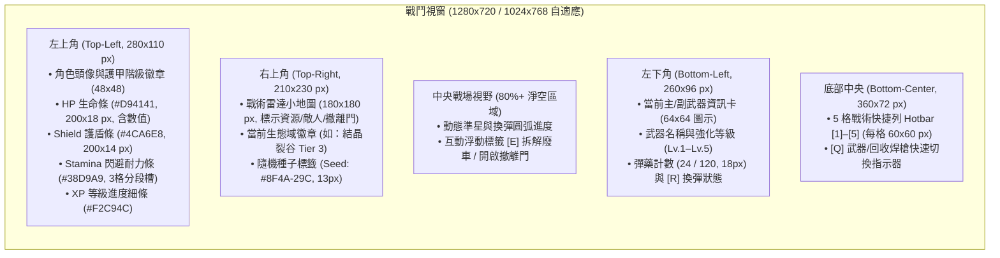

# 《廢土回收商 (Wasteland Recycler)》戰術像素 UI/UX 設計系統規範 (UI DESIGN SYSTEM)

> **文件版本**：v2.0 (AAA-Quality 廢土戰術像素 UI 重製規範)
> **制定單位**：美術總監與 UI/UX 總監 (`art-director`)
> **實際執行模型紀錄**：`Gemini 4 Argon (art-director subagent)`
> **本地化語言標準**：全繁體中文（Traditional Chinese `zh-TW`）+ 精準戰術數值標示

---

## 1. 字體排印與視覺層級規範 (Typography & Hierarchy)

為確保繁體中文複雜筆畫在像素風格下依然具備極致清晰度，全系統嚴禁無描邊裸字直接疊加於遊戲場景上，並統一採用 **5 級字號階梯** 與 **高對比暗色描邊（`#0B0D12`）**：

| 字級代號 (Type Token) | 字號 (`font_size`) | 描邊寬度 (`outline_size`) | 行高 / 字距 | 視覺職責與繁體中文應用場景 |
| :--- | :--- | :--- | :--- | :--- |
| **`Display-XL`** | **`32 px`** | `3 px` (`#0B0D12`) + 底部 `2px` 投影 | 行高 `1.2` | 主選單大標題（「廢土回收商」）、勝利撤離 / 戰死沙場結算主標題、首領登場橫幅 |
| **`Header-LG`** | **`24 px`** | `2 px` (`#0B0D12`) | 行高 `1.25` | 各大功能面板頂部標題（「武裝鍛造台」、「戰術模組強化」、「世界地圖選關」）、三選一升級大標題 |
| **`Title-MD`** | **`18 px`** | `2 px` (`#0B0D12`) | 行高 `1.3` | 武器/護甲卡片名稱（「電漿切割刃 Lv.3」）、彈匣大數字、區域名稱徽章、重要互動按鈕文字 |
| **`Body-SM`** | **`15 px`** | `1 px` (`#0B0D12`) | 行高 `1.4` | 道具屬性列表、任務提示、NPC 對話內文、背包格子數量、設定選單項目 |
| **`Caption-XS`** | **`13 px`** | `1 px` (`#0B0D12`) | 行高 `1.3` | 小地圖 `Seed` 編號、快捷鍵角標（`[1]`–`[5]`, `[Q]`, `[E]`, `[R]`）、次要冷卻秒數與狀態小標籤 |

---

## 2. 全局語意色彩變數 (UI Semantic Color Tokens)

所有 UI 面板、狀態條、按鈕與提示文字必須綁定以下標準色票 Token，嚴禁使用隨意硬編碼的刺眼純色：

| Token 名稱 | 色碼 (HEX / RGBA) | 視覺樣式與語意職責 |
| :--- | :--- | :--- |
| **`bg-slate-primary`** (面板主背景) | `#14181E` (`rgba(20, 24, 30, 0.94)`) | 深板岩戰術底色，提供極高文字對比度並微微透出背後場景光影 |
| **`bg-slate-elevated`** (插槽/卡片次背景) | `#1E242D` | 背包格子、裝備槽、商店商品卡與三選一升級卡的內層底色 |
| **`border-rust-default`** (面板鏽鐵外框) | `#5A4A3A` (內嵌 `#2A221B` 1px 暗線) | 預設 2px 雙層像素斜切角邊框（Chamfered Pixel Frame），呈現舊時代軍用終端質感 |
| **`accent-amber`** (戰術焦點琥珀) | `#E8A838` | 滑鼠懸停（Hover）外框、當前選中分頁、關鍵互動提示與換彈進度條 |
| **`status-hp-crimson`** (生命值深紅) | `#D94141` (暗部槽底 `#421616`) | 玩家與首領生命值（HP）計量條、危險低血量閃爍警示、爆頭/重傷提示 |
| **`status-shield-steel`** (護盾/護甲鋼藍) | `#4CA6E8` (高光 `#8CD0FF`) | 護盾/護甲耐久度計量條、防禦型模組圖示、低溫冷凍狀態提示 |
| **`status-stamina-cyan`** (耐力/閃避青綠) | `#38D9A9` | 戰術翻滾（`dodge_roll`）與衝刺耐力槽、武器能量核心充能條 |
| **`status-xp-gold`** (經驗/升級耀金) | `#F2C94C` | 等級經驗條、Roguelike 戰術升級卡金框、傳奇品質裝備與撤離獎勵高亮 |
| **`text-primary`** / **`text-muted`** | `#F0ECE1` / `#9BA4B0` | 主文字採用溫潤米白 `#F0ECE1`（避免純白刺眼），次要說明文字採用冷灰 `#9BA4B0` |

---

## 3. 互動元件五態回饋規範 (Interactive Component States)

所有按鈕、背包槽位、升級卡片與地圖節點必須實作完整的 5 種互動狀態，提供清脆的戰術終端操作手感：

| 元件狀態 (State) | 背景色變化 | 邊框與裝飾變化 | 微動態 (Micro-Animation) | 音效回饋 (Audio Cue) |
| :--- | :--- | :--- | :--- | :--- |
| **1. `Normal` (預設)** | `#1E242D` | `2px` 鏽鐵框 `#5A4A3A`，四角 `2x2 px` 鉚釘點綴 | `scale = (1.0, 1.0)`，位置偏移 `(0, 0)` | — |
| **2. `Hover` (懸停聚焦)** | 提亮至 `#28313D` | 外框切換為亮琥珀色 `#E8A838` (`2px`)，左側浮現 `▸` 戰術游標 | `Tween` 於 `0.08s` 內放大至 `scale = (1.03, 1.03)` 或上移 `y = -2px` | 輕脆機械滴答聲 (`ui_hover_tick.wav`, -12dB) |
| **3. `Pressed` (按下瞬間)** | 壓暗至 `#12161C` | 外框轉為高亮白金 `#F2C94C`，內部陰影反轉 | 瞬間下壓 `y = +2px`，`scale = (0.98, 0.98)` | 厚重金屬按鍵卡榫聲 (`ui_click_latch.wav`, -6dB) |
| **4. `Selected` (已選取/裝備中)** | `#252E3A` + 頂部琥珀漸層微光 | 持續常駐 `#E8A838` 雙線亮框 + 右上角顯示 `「已裝備」` 翡翠綠角標 (`#2E5A44`) | 外框四角高亮光點以 `1.5s` 週期呼吸閃爍 | 確認鎖定音 (`ui_select_lock.wav`) |
| **5. `Disabled` (禁用/材料不足)** | `rgba(20, 24, 30, 0.55)` | 暗灰邊框 `#323842`，文字降為 `#5C6470`（材料不足數值標紅 `#D94141`） | 禁止縮放；點擊時觸發左右水平震動 `±4px` (`0.15s`) | 低沉錯誤蜂鳴聲 (`ui_error_buzz.wav`) |

---

## 4. 全畫面佈局與視窗空間預算 (`1280x720` & `1024x768` Viewport Budgets)

為同時支援 `1280x720`（16:9 標準寬螢幕）與 `1024x768`（4:3 緊湊戰術視窗），所有 UI 採用 **九宮格邊緣錨點（Anchor Presets）+ 中央安全容器** 設計，確保在 `1024x768` 下絕不發生面板重疊或裁切。

### 4.1 戰鬥 HUD 佈局規範 (Combat HUD Layout)

**核心準則**：HUD 總遮擋面積嚴格控制在 **視窗面積的 14% 以內**，中央 `80%` 視野完全留給 2.5D 戰場與彈幕走位。

* **`1024x768` 窄螢幕自適應規則**：左下武器卡 (`260px`)、底部快捷列 (`360px`) 與右下留白保持至少 `32px` 間距（總寬度 `260 + 32 + 360 = 652px < 1024px`），絕不發生水平擠壓重疊。

---

### 4.2 主選單與開場畫面 (Main Menu / Intro Screen)
* **背景視覺**：全螢幕展示 R-17 背對鏡頭俯瞰廢土公路與遠方崩毀大都會的動態像素立繪（帶沙塵粒子、披風微動與背包 `#4BE3E3` 呼吸燈）。
* **左側戰術導航欄（距左邊界 `80px`，寬 `320px`）**：
  * 頂部：高質感繁體中文像素標誌 **《廢土回收商 WASTELAND RECYCLER》**（`32px` 主標題 + 鏽鐵裝甲底板）。
  * 按鈕序列（垂直間距 `14px`，每顆 `280x52 px`）：`▸ 開始回收作業 (新遊戲/繼續)`、`▸ 據點整備中心`、`▸ 戰術系統設定`、`▸ 離開廢土`。
  * 底部角落：版本號與操作提示（`WASD 移動 | 滑鼠瞄準射擊 | 空白鍵 翻滾 | Q 切換工具`）。

---

### 4.3 Roguelike 戰術升級三選一彈窗 (Tactical Upgrade 3-Card Modal)
* **觸發時機**：戰鬥中升級或開啟空投強化艙時，背景戰場套用 `rgba(10, 12, 16, 0.78)` 暗化模糊遮罩並暫停時間。
* **容器尺寸**：置中顯示 `880x460 px`（完美相容 `1024x768` 視窗）。
* **頂部橫幅**：`24px` 金色標題 **「戰術核心超載 — 選擇一項強化模組」**（`#F2C94C`）。
* **三張直立式戰術卡片（每張 `260x360 px`，水平間距 `24px`）**：
  * **頂部品質色帶**：普通（鋼藍 `#4CA6E8`）、稀有（裂谷紫 `#C850F0`）、傳奇（耀金 `#F2C94C`）。
  * **中央圖示框**：`80x80 px` 深色凹槽，展示 `64x64` 高精度模組圖示。
  * **標題與類型標籤**：`18px` 繁中名稱（如「高能電漿電容」）+ `13px` 類別標籤（`[遠程火力]` / `[生存護盾]` / `[回收效率]`）。
  * **數值加成明細**：`15px` 清晰條列，正向加成以翡翠綠 `#38D9A9` 標示（例如：`• 射擊傷害 +25%`、`• 換彈速度 +15%`）。
  * **底部互動提示**：懸停時卡片上浮 `-6px` 並亮起 `#E8A838` 琥珀金框，底部顯示 `「點擊或按 [1]/[2]/[3] 安裝」`。

---

### 4.4 據點六合一整備系統面板 (Equipment / Inventory / Forge / Shop / Mod / Recycle Panels)
為避免多重彈窗雜亂，據點與背包系統統一採用 **`960x600 px` 置中戰術終端框架**（在 `1024x768` 下四周仍保有 `32px+` 安全邊距），頂部設有一排切換分頁（Tabs），並固定分為左右雙欄佈局：

| 系統面板名稱 | 左欄佈局 (`420px` 寬：角色/工作台檢視) | 右欄佈局 (`500px` 寬：網格清單與操作明細) |
| :--- | :--- | :--- |
| **1. 裝備與背包 (Equipment & Inventory)** | 上方展示主角 R-17 動態預覽與 **三階護甲大圖示槽 (`128x128` px：初階/中階/高階)** + 主副武器槽；下方列出總合戰力指標（HP、護盾、移速、暴擊率） | `6 欄 × 5 列` 背包格網（每格 `68x68 px`，內嵌 `64x64` 道具圖示与右下角數量），底部附帶一鍵整理與負重條 |
| **2. 武裝鍛造台 (Weapon Forge)** | 展示選中武器之放大藍圖、`Lv.1 → Lv.2` 屬性躍升對比（綠字標示提升量）與熔爐火花動態特效 | 上方列出可鍛造/升級之武器清單；下方顯示所需廢土材料槽（如：精煉廢鐵 ×12、紫水晶核心 ×3）與大型琥珀色 **「啟動鍛造」** 按鈕 |
| **3. 改造模組插槽 (Mod Station)** | 顯示當前武器之 **3 至 4 個六角形/方形模組插槽環繞圖**，連線指向武器核心部位 | 右側列出已持有的 `64x64` 改造模組庫，支援點擊或拖曳鑲嵌，即時預覽詞條共鳴效果 |
| **4. 廢料回收分解機 (Scrap Recycler)** | 批量投入槽（最多 8 格）與「分解預覽產出區」，清晰顯示拆解後可獲得的基礎金屬、電子元件與結晶粉末數量 | 右側篩選「多餘裝備 / 廢棄雜物」，提供 **「一鍵選取普通廢料」** 與 **「啟動電漿拆解」** 按鈕（附帶進度條與火花音效） |
| **5. 黑市補給商店 (Wasteland Shop)** | 左側展示據點商人 NPC 立繪（`220x260` 乾淨剪影，無人工角標）與隨機戰術對話框 | 右側 `2×4` 商品陳列卡（含彈藥包、醫療針、稀有設計圖），右上角常駐玩家當前持有的「廢土信用點 / 核心廢料」餘額 |

---

### 4.5 世界地圖選關、暫停設定與結算畫面 (World Map, Pause/Settings, Death & Victory Screens)

1. **世界地圖出擊選關 (World Map Screen - `960x620 px`)**：
   * **視覺主體**：舊時代軍事衛星掃描風格的廢土全境地圖，以發光路線連接 **6 大生態域節點**（`scrap_highway`、`toxic_marsh`、`crystal_scar`、`old_factory`、`ruined_metropolis`、`underground_facility`）。
   * **右側情報簡報欄 (`320px` 寬)**：點選任一生態域節點後，顯示該區縮圖、危險等級（★1 至 ★6）、主要產出資源圖示、**環境危害警示（如：⚠ 水晶共鳴脈衝）**、自訂/隨機種子輸入框（`Seed Input`），以及醒目的 **「出發執行回收任務」** 按鈕。
2. **暫停與戰術設定選單 (Pause / Settings Modal - `560x480 px`)**：
   * 支援調整主音量 / 音效 / BGM 滑桿、視窗解析度切換（`1280x720` / `1024x768` / `1920x1080` / 全螢幕）、畫面震動強度（Screen Shake 0%–100%）與按鍵綁定一覽，並提供「返回戰鬥」、「放棄任務返回據點」選項。
3. **戰死沙場結算畫面 (Death Screen - 「訊號中斷 // 回收行動失敗」)**：
   * 畫面套用低飽和紅黑故障濾鏡，中央顯示 `32px` 深紅主標題 **「R-17 訊號中斷 — 行動失敗」**（`#D94141`）。
   * 統計面板列出本次存活時間、擊殺敵人數、死因（如：死於「結晶狂熱者」或「高壓蒸氣噴口」），以及**安全保底帶回的基礎廢料比例（30%）**，底部提供 **「緊急修復返回據點」** 與 **「同種子再次挑戰」** 按鈕。
4. **勝利撤離結算畫面 (Victory Extraction Screen - 「撤離成功 // 滿載歸來」)**：
   * 畫面綻放溫暖的翡翠綠與耀金光暈，頂部顯示 `32px` 耀金主標題 **「成功通過撤離門 — 回收任務完成！」**（`#F2C94C`）。
   * **戰利品展示牆**：以動態逐格彈出動畫（每格間隔 `0.08s` 伴隨清脆入庫音效）展示本次帶回的所有 `64x64` 武器、模組與稀有材料，下方結算總經驗值、破關時間、使用種子（`Seed`）與評價等級（`S / A / B`），底部設置 **「收下戰利品並返回據點」** 按鈕。
