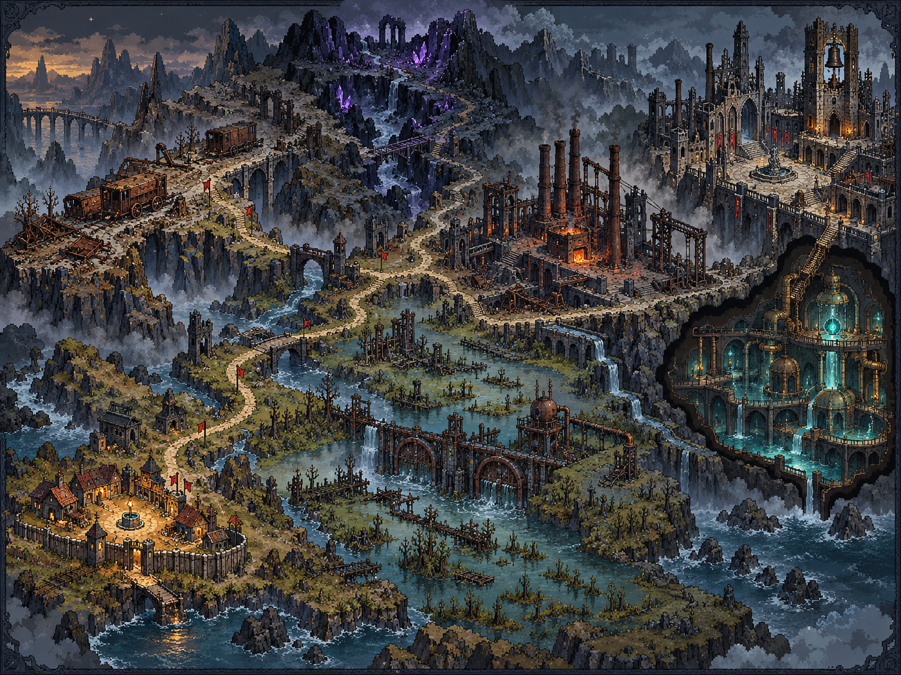
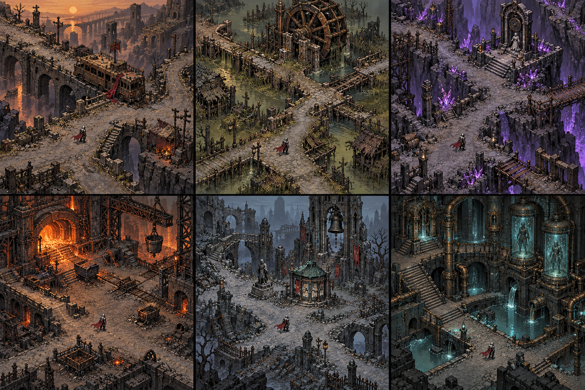

# Pixel world direction and AI handoff

## Current production entrypoints — 2026-10-24

The active production pass supersedes the older turnaround-only notes below.
Read these files rather than relying on a previous conversation:

- [Current correction after the user's full-scene rejection](world_v4/README.md).
- [Previous shared ground/prop material checkpoint](world_v3/README.md) — its
  composition approval was superseded by the user's visual rejection.
- [Preserved architecture kits and route composition](world_v2/README.md).
- [R-17 integrated blade production and actual facing/action counts](r17_v2/PRODUCTION_STATUS.md).
- [Current facing workflow and historical request provenance](r17_v2/facing-production/README.md)
  —Codex lead with Luna/xhigh workers; no current Gemini collaboration.
- [New v019 idle-only facing and native Player board](r17_v2/facing-production/intake-v019/README.md)
  —blade idle9, complete base8;23 idle requests remain, all11 actions incomplete.
- [Firearm/heavy grip artwork and activation contract](r17_v2/weapon_families.md).
- [Approved redesign plan](../ART_AND_COMBAT_REDESIGN_PLAN.md) and
  [current player rules/stories](../GAME_DESIGN.md).

Runtime adapters are `data/art/world_materials_v3.json`, `world_v2.json`, `r17_presentation_v2.json` and
`r17_weapon_families_v2.json`, in addition to the preserved legacy manifest.
Concept illustrations remain reference material. New sprites are unchanged source
PNGs with native nearest filtering and alpha clipping; original legacy art is
retained for fallback. Thirty-two real facings remain a production requirement,
not an achieved count merely because a sheet has thirty-two poses.

The user deferred tests in this pass. Ordinary isolated art renders establish
inspectable production output only; no current QA or release pass is implied.

Updated: 2026-10-22 (Asia/Taipei). English is the canonical technical direction.
The user's mandatory medium is **pixel art**. The reference is the oppressive dark
fantasy atmosphere and varied exploration spaces of Path of Exile, expressed in
an original industrial wasteland with the existing R-17 knight and village story.

## Reference images

The world overview is also the illustrated background of the in-game G atlas.
The village is the small warm sanctuary, the road follows evacuation traces,
waterworks connect the settlements, and the final vault appears beneath the city
as an underground cutaway. The illustration conveys world relationships; use the
M map and actual route data for traversal coordinates and collision geometry.

Read panels left to right, then top to bottom: scrap highway, toxic marsh, crystal
scar, old foundry, ruined city, underground facility. Each has a distinct landmark,
material vocabulary, playable ground, side passages and environmental evidence.
These are composition targets. The runtime now combines expanded route networks,
authored points and regional modular architecture. Gothic towers, furnaces,
laboratories and crystal buttresses are implemented through `world_v2`; the
plates' complete density, interiors and vertical traversal remain future work.

## Visual rules

- Keep the high oblique camera and existing planar movement/collision model.
  Render visible tops/fronts on sprites; don't rotate the physics world into a new
  projection to imitate a reference plate.
- Use crisp clustered pixels, stepped silhouettes and nearest texture filtering.
  Keep walkable surfaces quiet and props readable at the actual game camera scale.
  Avoid turning fine ornamental detail into flickering noise.
- Base colors: charcoal, slate blue, rusty brown and dead olive. Amber identifies
  sanctuary/interaction, restrained violet identifies crystal energy, cyan identifies
  preserved memory/water machinery. Damage warnings need high contrast.
- Build regional identity from silhouettes and traversal structure: highway forks,
  marsh causeways, ravine terraces, foundry courts, city loops and vault corridors.
- Keep the gold faceplate, blue-gray armor and crimson cape of the approved
  R-17. V2 sources draw body, hands and held weapon together and hide the legacy
  icon overlay, so the weapon appears once at a coherent scale.
- Preserve the six investigation landmarks and their approach/collision clearances.
  Maintain a safe readable return route; optional encounter rewards go on branches.

## Implemented expansion

| Route | World pixels | Named regions | Guarded exploration points |
| --- | --- | --- | --- |
| `scrap_highway` | 7168 × 5376 | 4 | 3 |
| `toxic_marsh` | 6656 × 5888 | 4 | 3 |
| `crystal_scar` | 6912 × 5888 | 4 | 3 |
| `old_factory` | 7168 × 5632 | 4 | 3 |
| `ruined_metropolis` | 7424 × 6144 | 4 | 3 |
| `underground_facility` | 6656 × 6144 | 4 | 3 |

Each route has five connected path polylines, three authored guarded reward sites,
a story evidence site and the village return. Approaching a guarded site starts
its three-enemy encounter; E claims its listed reward after the guards die. The
existing 50-enemy cap includes guards. Existing route-scoped generic discovery
IDs persist claims, including compatibility with older bare IDs. Re-entering a
claimed site cannot grant its reward again.

The G world atlas displays six destinations, contract prerequisites, objectives
and discovery state. M shows the actual local road network and markers. New scene
entrances use a short native pixel curtain, region title and small amber motes;
Enter, Space or Escape skips the arrival title. The cinematic holds gameplay while
it plays. Combat anticipation gives enemies a readable windup and recovery.

## Preserved first-generation directional contract

The following sources still support enemies and hero fallbacks. V2 hero
production supersedes their separate-body/weapon presentation; use the current
production entrypoints above for active hero crop/scale/action data.

The parent agent generated the world plates, seven enemy turnarounds and one R-17
turnaround with the built-in `image_gen` tool. Original authored PNGs are retained.
The new images were copied without pixel edits. Exact inputs are preserved in
[GENERATION_PROMPTS.md](GENERATION_PROMPTS.md).

- Enemy sources: `assets/sprites/enemies/<enemy_id>_8dir.png`, all seven enemy IDs.
- Hero source: `assets/sprites/player/r17_directional_body.png`.
- Direction order: E, SE, S, SW, W, NW, N, NE.
- Native source dimensions are **1774 × 887**. Generated spacing is uneven; do not
  derive frames by dividing width by four. `data/art/visual_assets.json` contains
  eight explicit `directional_rects` and absolute `directional_feet` per source.
  R-17 also has `directional_hands` for the equipment pivot.
- Rectangles were measured from visible alpha, excluding almost-transparent edge
  noise, then padded. Runtime crops via `AtlasTexture` and applies a shared scale
  and ground anchor; image files are unchanged. Source dimensions and SHA-256 are
  registered beside each directional asset reference.
- Enemy bodies are eight independently depicted standing views. R-17 additionally
  has two eight-view walking contact keys; see `../PLAYER_MOTION.md`. Weapon,
  recoil and hit motion use native runtime pose curves at 60 physics ticks.
  These do not constitute eight fully
  hand-animated action strips; the preserved old death animation remains in use.
- Use rendered directional contact sheets and gameplay captures to review weapon
  placement, feet, silhouette and readability. Automated distinct-frame checks
  alone do not establish animation quality.

## Next AI entrypoint

Read `AGENTS.md`, `AI_HANDOFF.md`, `docs/STORY_AND_SCENES.md`, this file and current
`docs/RELEASE_READINESS.md`. Inspect the actual latest Git state before changing
anything. Use GPT-6.1-sol / high for delegated agents as the user most recently requested.

Continue art production and integration first; current user direction excludes
tests and QA. When that direction changes, play the six chapter contracts and record travel time,
encounter spacing, readable tells, ammo/EP economy, unclear leads and whether the
ending pays off the red-scarf/water mystery. Refine one route at a time from that
evidence. Extend the existing city/foundry architectural kits to bring the runtime
closer to these references while retaining path clearance, existing saves and the
current frame budget. Inspect screenshots after every composition change.

## 給下一位 AI／開發者的閱讀提示

像素風格是必要條件。先看上方世界總覽與六區構圖，再開遊戲按 G 看世界紀行、
按 M 看實際道路與據點。十八個新據點都有守衛與一次性獎勵；故事線仍從村莊
缺水、撤離名冊、紅圍巾一路延伸至地下記憶與淨水設施。

新版主角維持藍灰鎧甲、金色面甲與紅披風；七種敵人都有八個方向。切圖務必讀
美術資料中的明確矩形與腳底點。目前依指示先補美術與流程，不執行測試；
後續獲准驗證時再量測移動與戰鬥節奏，逐區補齊探索密度與敘事場景。
參考圖的完整密度與立體通行方式仍未全部實作。
