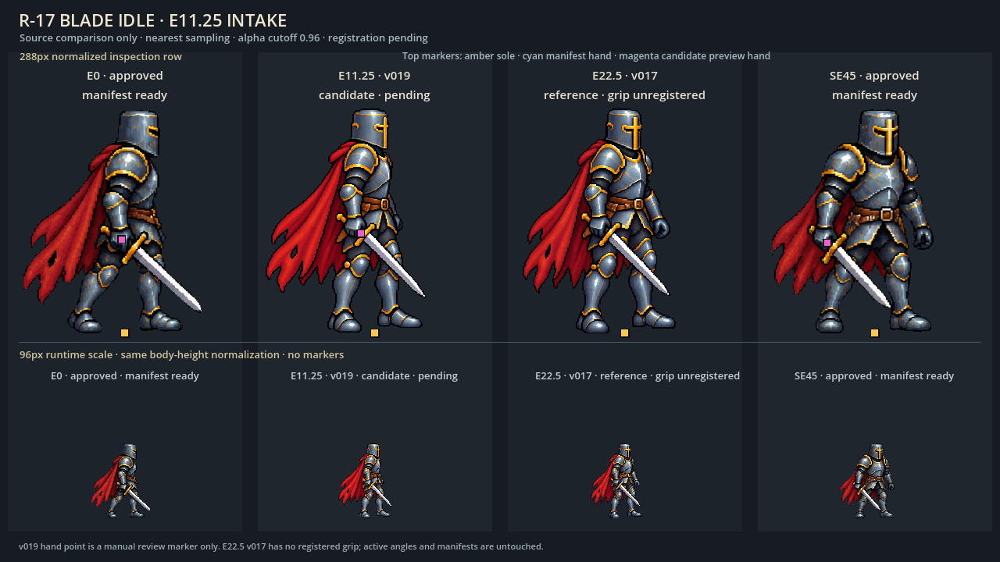
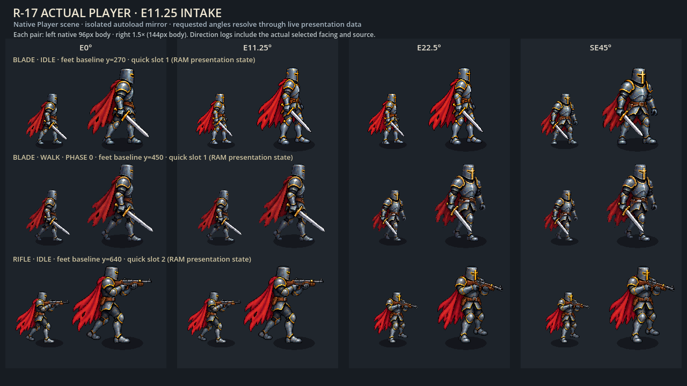

# R-17 v019 — first partial facing integration

2026-10-24. Built-in imagegen production and ordinary native art presentation.
Codex lead reviewed and integrated the selected image; in-session workers used
GPT-6-Luna/max. No Gemini, API-key/CLI image fallback or automated QA was used.

Two actual images were generated. v018 repeated too much of the inactive v017
perspective and was rejected; its raw output remains in the generator's external
folder. v019 was generated using approved E0/SE45 and inactive v017 references,
copied byte-for-byte into the project, then reviewed at288px/96px and in the
actual frozen Player at96px/144px. The armor, cape, sword scale, soles and grip
remain coherent in those views. Visual review supports a distinct shallow
perspective; it cannot certify an exact camera azimuth.

Selected source:
`assets/sprites/player/redesign_v2/source/angular_candidates/r17_blade_idle_e11_25_v019.png`
under the project root;1024x1536 RGBA, SHA-256
`b738ba7663f9f2774a8434b0dc56648134de35da04621513db23a7b76e859e0a`.
Raw alpha is retained; existing native0.96 clipping and nearest sampling apply.
Cell registration is `[0,0,1024,1536,616,1337,545,839,1123]`.

`r17_presentation_v2.json` adds this view only through
`blade.additional_action_facings.idle`. Player independently validates extra
angles, slot counts, textures, crop/sole/grip/muzzle bounds and keeps the base
family when an extra is invalid. Merged action angles are cached at load, not
rebuilt every frame. No movement, collision, damage, action timing or save
ownership changed for the hero.

| Coverage | Current |
| --- | --- |
| Complete base views / shared `actual_facing_count` |8 |
| Blade idle |9;23 intermediate views remain |
| Blade walk/strike and other weapon actions |8; existing keys retained |
| Complete32 views across all11 requested actions |Incomplete |

The actual Player board labels **requested** directions. At22.5 the idle still
selects11.25, while walk/rifle select their existing nearest45 in this frame.
Those repeated selections are not additional drawings. The single idle extension
does not establish a smooth32-direction movement/attack transition.

Both final ordinary render processes were observed exiting0 with PNG result0
and no observed ERROR/WARNING lines. The comparison uses no game autoloads; the
actual Player uses an isolated five-autoload mirror with paused tree/disabled
actors, staged quick slot/direction/pose RAM and native presentation calls only.
The lead opened both final images. Initial viewer drafts failed parsing (one
undefined preview helper, one inferred Variant warning); those logs remain,
the blank processes were explicitly stopped, and repaired viewers produced the
final images. Failed draft source snapshots were not retained.

[production_receipt.json](production_receipt.json) records prompts, raw source
hashes, registrations, viewer recipes, outputs, earlier errors and the current
request-builder execution. Its linked113-input snapshot covers the listed mirror
inputs only. No gameplay input, action, projectile/collision, payload IO,
performance or QA ran. Pacing and release acceptance remain open.

The builder now accounts for valid **idle-only** extra registrations. Its one
production execution emitted23 missing requests, base8/idle9, exit0, runtime
delta0. External output is recorded; regenerate from the portable script and
current manifests on another platform. The older24-request batch is historical
and remains unchanged. Brackets deliberately use complete base reference cells.

`preview/` is a standalone source-only comparison project: absolute
`--r17-root=` and `--art-output=` (PNG path or directory), dedicated custom user
dir. Copy `actual_player.gd.txt`/`.tscn.txt` into a project mirror with custom dir
`R17-Ordinary-Art-Preview-20261023` and pass an absolute PNG `--art-output=`.
Verify the discovered engine version before use; final renders used Godot4.6.3.

繁體中文：已新增並接入一張持劍待機轉身圖；待機9方向，其餘仍8方向。未完成
32方向、11種動作或60FPS遊戲驗收。原圖與舊版保留，工具提示詞不計作完成素材。
